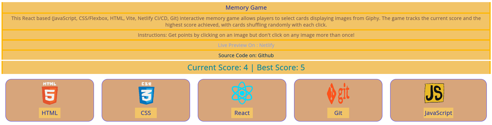

# Memory Card Game

An interactive React-based memory game where players select image cards, test their memory, and compete against their highest score.

## Table of Contents

- [Overview](#overview)

- [Features](#features)

- [Screenshots](#screenshots)

- [Tech Stack](#tech-stack)

- [Architecture](#architecture)

- [Getting Started](#getting-started)
  - [Prerequisites](#prerequisites)

  - [Installation](#installation)

  - [Environment Variables](#environment-variables)

- [Project Structure](#project-structure)

- [Available Scripts](#available-scripts)

- [Development](#development)

- [Testing](#testing)

- [Deployment](#deployment)

- [Troubleshooting](#troubleshooting)

- [Contributing](#contributing)

- [License](#license)

- [Acknowledgements](#acknowledgements)

- [Contact](#contact)

---

## Overview

Memory Card Game is a browser-based interactive game developed using React and JavaScript.

Players select cards displaying images sourced from Giphy and attempt to remember which cards they have previously selected.

The application tracks the player's current score and highest score, while randomly shuffling the cards after each selection.

The project demonstrates frontend development concepts, including React components, application state management, user interaction and responsive interface development.

## Live Demo : [Memory Card Game](https://amal-memory-card-game.netlify.app/)

## Features

- **Interactive Memory Game:** Select image cards and test your memory through repeated selections.

- **Giphy Images:** Display image content sourced from Giphy.

- **Current Score Tracking:** Keep track of the player's score throughout gameplay.

- **Highest Score Tracking:** Track the highest score achieved by the player.

- **Random Card Shuffling:** Randomise the card arrangement following each selection.

- **React Components:** Organise the application interface into reusable React components.

## Screenshots



## Tech Stack

| Category          | Technology                |
| ----------------- | ------------------------- |
| Frontend          | React 18                  |
| Language          | JavaScript (ES Modules)   |
| Markup            | HTML5                     |
| Styling           | CSS3 / Flexbox            |
| Build Tool        | Vite 7                    |
| Bundler           | Vite                      |
| Linting           | ESLint 9                  |
| React Integration | Vite React Plugin         |
| Package Manager   | pnpm (preferred)          |
| Existing Lockfile | npm (`package-lock.json`) |
| Version Control   | Git / GitHub              |
| Hosting           | Netlify                   |

### Dependencies

**Production Dependencies**

| Package     | Purpose                                    |
| ----------- | ------------------------------------------ |
| `react`     | Component-based user interface development |
| `react-dom` | Rendering React components in the browser  |

**Development Dependencies**

| Package                       | Purpose                                         |
| ----------------------------- | ----------------------------------------------- |
| `vite`                        | Development server and production build tooling |
| `@vitejs/plugin-react`        | React integration for Vite                      |
| `eslint`                      | JavaScript linting                              |
| `@eslint/js`                  | ESLint's JavaScript configuration               |
| `eslint-plugin-react`         | React-specific linting rules                    |
| `eslint-plugin-react-hooks`   | React Hooks linting rules                       |
| `eslint-plugin-react-refresh` | React Fast Refresh linting support              |
| `globals`                     | Global variable definitions for ESLint          |
| `@types/react`                | React type definitions                          |
| `@types/react-dom`            | React DOM type definitions                      |

## Architecture

The application uses a React-based frontend architecture with Vite providing the development environment and production build process.

### Application Structure

- **React:** Manages the user interface and component rendering.

- **Components:** Encapsulate reusable interface elements, including the card component.

- **Application Logic:** Handles card selection, score tracking and card shuffling.

- **External Image Content:** Uses Giphy image content, with image URLs supplied to the card component.

- **Vite:** Provides the local development server and generates production assets.

### Application Flow

1.  Vite serves the application during development.

2.  React renders the application interface.

3.  Image cards display their associated image content.

4.  Players interact with the cards.

5.  The application updates the current score and highest score.

6.  Cards are shuffled following each selection.

## Getting Started

### Prerequisites

Ensure the following tools are installed:

- **Node.js:** Version 20 or later, as documented in the original project setup instructions.

- **pnpm:** Preferred package manager.

- **Git:** For cloning and managing the repository.

- **Code Editor:** Visual Studio Code or another JavaScript-compatible editor.

### Installation

1.  **Clone the repository:**

    ```
    git clone https://github.com/amalk-au/memory-card-game.git
    cd memory-card-game
    ```

2.  **Enable pnpm using Corepack (if necessary):**

    ```
    corepack enable
    ```

3.  **Install dependencies:**

    ```
    pnpm install
    ```

    The repository currently contains an npm lockfile (`package-lock.json`) rather than a pnpm lockfile.

    If pnpm is your preferred package manager, running `pnpm install` will generate a `pnpm-lock.yaml` file. Commit this file if you intend to standardise the project on pnpm.

4.  **Start the development server:**

    ```
    pnpm dev
    ```

5.  **Open the application:**

    Visit the local URL displayed in your terminal, typically:

    ```
    http://localhost:5173
    ```

## Project Structure

The repository uses a Vite-based React application structure.

```
memory-card-game/
├── public/                  # Public static assets
├── src/                     # React application source code
│   └── components/
│       └── Card.jsx         # Card presentation component
├── docs/
│   └── screenshots/         # Project screenshots (to be added)
├── .gitignore               # Git ignore configuration
├── eslint.config.js          # ESLint configuration
├── index.html                # Application HTML entry point
├── package.json              # Dependencies and npm scripts
├── package-lock.json         # Existing npm dependency lockfile
├── vite.config.js            # Vite configuration
├── LICENSE                   # GPL-3.0 licence
└── README.md                 # Project documentation
```

**Note:** The `docs/screenshots/` directory is a suggested documentation directory and needs to be created. The existing repository contains additional source files under `src/` that are not individually enumerated above.

## Available Scripts

The following commands are defined in `package.json`.

| Command        | Description                             |
| -------------- | --------------------------------------- |
| `pnpm dev`     | Start the Vite development server.      |
| `pnpm build`   | Generate an optimised production build. |
| `pnpm preview` | Preview the production build locally.   |
| `pnpm lint`    | Run ESLint against the project.         |

### Production Build

Generate the production build:

```
pnpm build
```

Vite outputs the production assets to the `dist/` directory by default.

### Preview Production Build

```
pnpm preview
```

### Linting

```
pnpm lint
```

## Development

Follow these guidelines when modifying the project:

1.  Create a feature branch for your changes.

2.  Follow the existing React component structure and JavaScript conventions.

3.  Keep components focused and reusable.

4.  Maintain consistent CSS naming and styling conventions.

5.  Avoid introducing unnecessary dependencies.

6.  Run ESLint before committing changes.

7.  Verify that the application builds successfully.

8.  Commit your changes with descriptive commit messages.

Keep changes focused, maintainable and well-documented.

## Testing

The current `package.json` does not define a dedicated automated testing script or testing framework.

For basic verification, run:

**Linting:**

```
pnpm lint
```

**Production Build:**

```
pnpm build
```

After making changes, manually verify:

- The application loads successfully.

- Cards display their expected images.

- Card selection works correctly.

- The current score updates as expected.

- The highest score is tracked correctly.

- Card shuffling works after selections.

- The application behaves correctly across different screen sizes.

Automated unit, integration and end-to-end testing are not currently documented as part of the project configuration.

## Deployment

The application is deployed using Netlify.

**Live Application:** [https://amal-memory-card-game.netlify.app/](https://amal-memory-card-game.netlify.app/)

### Deployment Configuration

| Configuration     | Details                |
| ----------------- | ---------------------- |
| Hosting Platform  | Netlify                |
| Framework         | React                  |
| Build Tool        | Vite                   |
| Build Command     | `pnpm build`           |
| Publish Directory | `dist`                 |
| Production Output | Static frontend assets |

### Deployment Process

1.  Push the latest changes to the GitHub repository.

2.  Ensure Netlify is connected to the repository.

3.  Configure the build command as `pnpm build`.

4.  Configure the publish directory as `dist`.

5.  Deploy the application through Netlify.

If Netlify uses automatic deployments, new commits pushed to the configured production branch can trigger a new deployment.

### Subdirectory Deployment

The current live demo is hosted at the Netlify root domain.

If the application is later deployed under a portfolio subdirectory, update the Vite `base` configuration to match the deployment path.

For example, a deployment under `/memory-card-game/` would require:

```
export default defineConfig({
  base: '/memory-card-game/',
  plugins: [react()],
})
```

The current `vite.config.js` does not explicitly configure a subdirectory base path.

## Troubleshooting

| Issue                                        | Solution                                                                                       |
| -------------------------------------------- | ---------------------------------------------------------------------------------------------- |
| Dependency installation fails                | Verify your Node.js and pnpm versions, then retry installation.                                |
| Development server fails to start            | Check that dependencies are installed and the required port is available.                      |
| Images fail to load                          | Check network connectivity and verify the image URLs or fallback URLs used by the application. |
| Production build fails                       | Run `pnpm lint` and inspect the build output for errors.                                       |
| Application assets fail under a subdirectory | Verify the Vite `base` configuration matches the deployment path.                              |

## Contributing

Contributions and suggestions are welcome.

1.  Fork the repository.

2.  Create a feature branch.

3.  Implement your changes.

4.  Run the available linting and build commands.

5.  Commit your changes with descriptive messages.

6.  Open a pull request.

For significant changes, consider opening an issue first to discuss the proposed implementation.

## License

This project is licensed under the **GNU General Public License v3.0 (GPL-3.0)**.

You are free to use, modify and distribute this software under the terms of the licence.

See [LICENSE](./LICENSE) for the complete licence text.

## Acknowledgements

- **React:** For the component-based frontend library.

- **Vite:** For the development server and build tooling.

- **Giphy:** For the image content used in the memory game.

- **Netlify:** For hosting and deployment.

- **Open-source community:** For the tools and libraries that support this project.

## Contact

- **Author:** Amal K.

- **GitHub:** [@amalk-au](https://github.com/amalk-au)

- **Repository:** [Memory Card Game](https://github.com/amalk-au/memory-card-game)

- **Issues:** [GitHub Issues](https://github.com/amalk-au/memory-card-game/issues)

- **Portfolio:** [amalk.au](https://amalk.au)

---

<p align="center">Developed by <a href="[https://github.com/amalk-au](https://github.com/amalk-au)">amalk-au</a></p>
